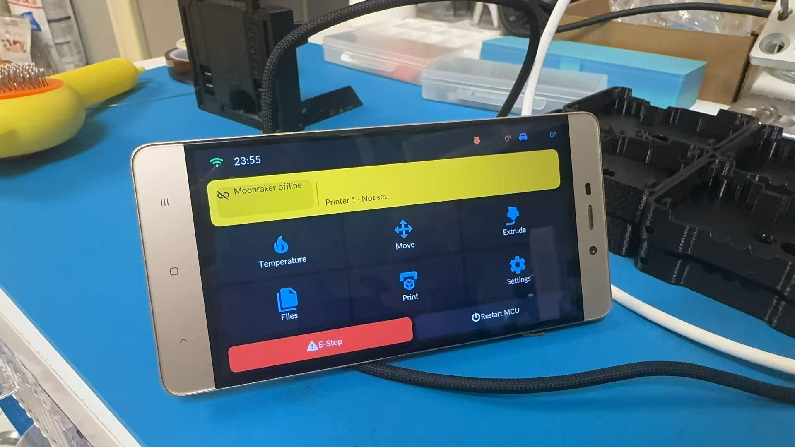

# Linux client

**Packages**: [desktop-linux-x86_64.tar.gz](https://github.com/umeiko/KlipperScreen-esp/releases/latest/download/desktop-linux-x86_64.tar.gz) / [desktop-linux-arm64.tar.gz](https://github.com/umeiko/KlipperScreen-esp/releases/latest/download/desktop-linux-arm64.tar.gz) / [desktop-linux-armhf.tar.gz](https://github.com/umeiko/KlipperScreen-esp/releases/latest/download/desktop-linux-armhf.tar.gz)



*No ESP32 at all — run the same UI directly on the printer's Linux host (shown: a retired Redmi 4 phone, aarch64 Ubuntu 24.04, weston kiosk backend). A phone/tablet running a Linux chroot/proot works too.*

The desktop build targets Debian/Ubuntu-family Linux hosts (glibc ≥ 2.35, x86_64 and arm64) as a lightweight KlipperScreen alternative — prebuilt binaries that statically link SDL2/cJSON, no compilation on the host.

### One-line install

```bash
curl -fsSL https://raw.githubusercontent.com/umeiko/KlipperScreen-esp/main/scripts/linux/install.sh | bash
```

The installer detects your architecture, downloads the matching prebuilt package from the latest release, then asks how you want it installed:

- **Dedicated display service (default)** — a `KlipperScreen-esp.service` systemd unit starts the UI fullscreen on boot through a Wayland (weston kiosk shell) or X11 (bare xinit) backend of your choice; the required packages (`weston` or `xinit`) are installed automatically. If `KlipperScreen.service` is detected, the installer offers to disable it so the two don't fight over the screen
- **Desktop app** — just the binary plus a launcher shortcut in the applications menu

Files land in `~/.local/share/KlipperScreen-esp/`, configuration in `~/.config/KlipperScreen-esp/`.

### Manual install

Download `desktop-linux-x86_64.tar.gz` or `desktop-linux-arm64.tar.gz` from [Releases](https://github.com/umeiko/KlipperScreen-esp/releases/latest), extract, and run `./install.sh`. Non-interactive usage for scripted deployments:

```bash
SERVICE=n ./install.sh                  # desktop app only
KR_BACKEND=x11 ./install.sh             # service mode, force X11
KR_BACKEND=wayland KR_START=0 ./install.sh
```

Uninstall with the bundled `./uninstall.sh`.

### Notes

- At 720p and above the UI switches to the large-font/icon tier automatically, and the boot animation is skipped on high-resolution Linux hosts for a faster start.
- Touch input works through the kernel's evdev/libinput stack — both weston and xinit backends forward it transparently.
- On Klipper hosts (`~/printer_data` present), config lives in `~/printer_data/config/KlipperScreen-esp/` so fluidd/mainsail can view and edit it directly, and service logs land in `~/printer_data/logs/KlipperScreen-esp.log` (downloadable from the web UI). Every app-written config also refreshes a `.bak` checkpoint — if a hand edit breaks the main file, the last known-good copy is used instead of crashing. On first boot, printer slot 1 is pre-filled with the local Moonraker (`127.0.0.1`, named after the login user).
- Building from source instead: see [Building from source](../building.md).

### Weston session recovery (since 0.7.7)

The Wayland launcher supervises both Weston and the app. If either exits, it stops the other and systemd restarts the complete display session after 2 seconds. A 5-second socket-readiness timeout prevents starting the app without a compositor. Cleanup sends TERM, then KILL after at most 5 seconds; the service stop timeout is 10 seconds. A private `klipperscreen-esp` socket leaves other sessions' `wayland-0` untouched.

The installer always installs a backlight udev rule; each service start also restores `video` group write access to `/sys/class/backlight/*/brightness`. Re-run the installer once on old installations to update the systemd unit and permission rules. In-app updates replace the binary and launcher but do not modify privileged system units.

On a Redmi 4, Weston aborted in `weston_output_finish_frame` after a backwards frame timestamp, while the app stayed alive, leaving a black screen with its backlight and SSH still working. This recovery addresses the aftermath, not the underlying non-mainline kernel/DRM timestamp bug. It does not disable the GPU, change rotation/scaling or raise the frame rate. A display/kernel hang with both processes still alive is not covered by process-exit supervision.

Preserve evidence before rebooting the host:

```bash
systemctl status KlipperScreen-esp --no-pager
pgrep -a weston
tail -100 ~/printer_data/logs/KlipperScreen-esp.log
```

To recover just the display session, run `sudo systemctl restart KlipperScreen-esp`; Moonraker, Klipper and Linux are not restarted.

---
