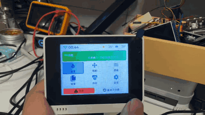
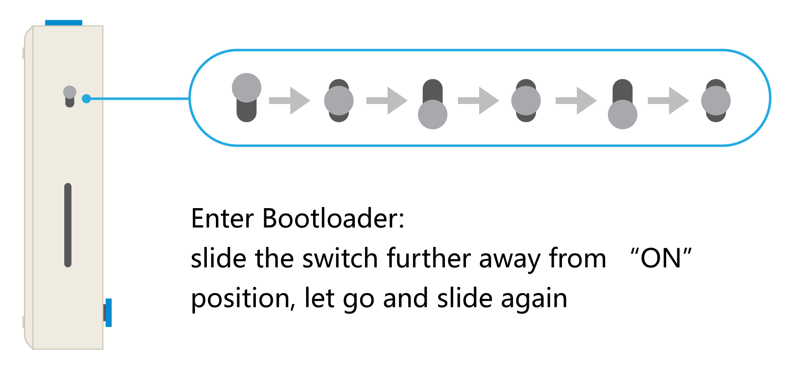

# Seeed Wio Terminal

KlipperScreen-esp 已支持 Wio Terminal 的 ATSAMD51 + RTL8720DN 新架构。屏幕无触摸：五向开关负责上下左右，按下开关是确认，机身顶部 C 键是返回。



## 下载与首次刷机

下载最新正式版 [KlipperScreen-esp-Wio-Terminal.uf2](https://github.com/umeiko/KlipperScreen-esp/releases/latest/download/KlipperScreen-esp-Wio-Terminal.uf2)，然后：

1. 用支持数据传输的 USB-C 线连接并打开 Wio Terminal。
2. **快速拨动电源/复位开关两次**。蓝色 LED 开始呼吸后，电脑会出现通常名为 `Arduino` 的可移动盘。
3. 把下载的 `.uf2` 文件复制到这个磁盘。复制完成后磁盘会自动消失，设备重启进入 KlipperScreen-esp。



*Bootloader 示意图来自 [Seeed Studio《Get Started with Wio Terminal》](https://wiki.seeedstudio.com/Wio-Terminal-Getting-Started/)。*

!!! tip
    如果蓝灯呼吸但复制一直不动，先拔线彻底断电，换主板直连 USB 口或另一台电脑；后面的“USB 恢复”章节记录了 Windows 驱动节点的清理方法。

## 首次更新 Wi-Fi 固件

Wio Terminal 的 Wi-Fi 由独立的 RTL8720DN 协处理器提供。首次使用时应按 Seeed 官方流程更新到 eRPC 固件；以后只有扫描失败、SSID 空白、连接永久等待等异常时才需要重刷。

1. 下载或克隆 [Seeed ambd_flash_tool](https://github.com/Seeed-Studio/ambd_flash_tool)，关闭 Arduino IDE、串口监视器和所有占用 Wio 串口的程序。
2. Wio 正常开机并连接电脑。**仍是出厂旧固件的设备只需执行一次 `erase`**：

   ```powershell
   .\ambd_flash_tool.exe erase
   ```

3. 写入最新无线固件：

   ```powershell
   .\ambd_flash_tool.exe flash
   ```

   Linux / macOS 把命令分别换成 `python3 ambd_flash_tool.py erase` 和 `python3 ambd_flash_tool.py flash`。
4. 工具完成后重新上电，再按上面的 UF2 步骤刷入 KlipperScreen-esp。RTL8720DN 固件与 SAMD51 应用固件是两套独立固件。

详细官方步骤见 [Seeed Wio Terminal Network Overview](https://wiki.seeedstudio.com/Wio-Terminal-Network-Overview/)。

以下内容面向自行构建和故障排查。端口源码位于 `src/ports/wio_terminal/`，CI 使用联网依赖环境 `wio-terminal`，开发机可使用离线环境 `wio-terminal-local`。

## 硬件与存储边界

- 主控：ATSAMD51P19A，120MHz，192KB RAM，512KB 内置程序 Flash。
- 屏幕：320×240 ILI9341，无触摸；五向开关负责方向和确认，顶部 C 键负责返回。
- 无线协处理器：RTL8720DN，经 Seeed `rpcWiFi` / eRPC 与 SAMD51 通信。
- 外置存储：4MiB W25Q32 QSPI Flash。目前开头三个 4KB 扇区分别保存网络、显示和 Moonraker 配置，64KB 以后预留资源包。

内置 Flash 的前 16KB 是 UF2/BOSSA Bootloader，应用从 `0x4000` 开始，最多 507904 字节（496KiB）。外置 QSPI 与内置程序 Flash 是两颗物理芯片，不能像 ESP32 分区表那样从“文件系统”直接划容量给程序。若应用空间吃紧，应裁掉程序中的重复表或把完整资源包设计成独立的 QSPI 烧录步骤，不能覆盖 Bootloader。

打印“微调”面板在 Wio 上暂不开放：固定 320×240 布局、复用图标并共用百分比步长后，试编仍超过程序 Flash 上限。能力门控为 `BSP_HAS_FINE_TUNE`，其他平台在打印中/暂停时从打印状态页右上角进入。

手动调平（`bed_level`）本轮也通过 `BSP_HAS_BED_LEVEL` 裁剪，以保留 Wio 极少的程序 Flash 余量。

当前 Wio 字体采用三级回退：UI 必需汉字及高频前 512 字使用 12px/1bpp；机械、电子、3D 打印领域字与频率第 513–1024 字共同使用 10px/1bpp，领域字晋级时等量下放第二档末尾的非领域普通字；其余频率字使用 8px/1bpp。ASCII、LVGL 图标和 Latin-1 字体不带 kerning 表。第三级使用紧凑码表和打包字形参数以节省 Flash，回调输出的字宽必须把 `lv_font_conv` 的 1/16 像素 advance 转换成实际像素。字库清单分别位于 `tools/fontgen/common_zh_*.txt` 和 `tools/fontgen/domain_zh.txt`。执行下面命令重新生成：

```powershell
python tools/fontgen/gen_wio_fonts.py
```

## RTL8720DN 网卡固件

Wio Terminal 的 Wi-Fi 不是 SAMD51 内置外设。RTL8720DN 固件过旧或异常时，典型现象包括：扫描始终失败、SSID 空白、输入密码后永久阻塞、eRPC 调用不返回，或者只在更换电脑后暂时恢复。

首次使用或出现上述现象时，先按 Seeed 官方流程升级无线核心：

1. 下载 [Seeed ambd_flash_tool](https://github.com/Seeed-Studio/ambd_flash_tool)，关闭 Arduino IDE、串口监视器和其他占用 Wio 串口的程序。
2. Wio 正常接入 USB。工具会自动识别端口，并临时让 SAMD51 转发 RTL8720DN 的烧录串口。
3. Windows 在工具目录执行：

   ```powershell
   .\ambd_flash_tool.exe flash
   ```

   Linux/macOS 执行：

   ```bash
   python3 ambd_flash_tool.py flash
   ```

4. 若必须指定离线固件目录，使用 `flash -d <目录>`；目录必须包含 `km0_boot_all.bin`、`km0_km4_image2.bin` 和 `km4_boot_all.bin`。固件来源为 [Seeed seeed-ambd-firmware](https://github.com/Seeed-Studio/seeed-ambd-firmware)。
5. 网卡固件完成后重新上电，再烧录本项目的 SAMD51 应用固件。两类固件彼此独立。

本项目另外在构建时给 Seeed eRPC 客户端打 15 秒超时补丁，并把关联过程放进工作任务；这样 RTL8720DN 丢回复时只会连接失败，不再永久卡死 LVGL。

## 本地构建与上传

安装 PlatformIO 后，在仓库根目录执行：

```powershell
$pio = "$env:USERPROFILE\.platformio\penv\Scripts\pio.exe"
Push-Location src/ports/wio_terminal
& $pio run -e wio-terminal-local
& $pio run -e wio-terminal-local -t upload --upload-port COM3
Pop-Location

python tools/make_uf2.py `
  src/ports/wio_terminal/.pio/build/wio-terminal-local/firmware.bin `
  src/ports/wio_terminal/.pio/build/wio-terminal-local/firmware.uf2
```

把 `COM3` 换成设备实际的应用串口。构建产物位于：

- `.pio/build/wio-terminal-local/firmware.bin`
- `.pio/build/wio-terminal-local/firmware.uf2`

上传命令先以 1200 baud 打开并关闭应用串口，触发 Bootloader，然后等待重新枚举的下载端口并用 BOSSA 写入。一次上传中端口号改变属于正常现象。

也可以快速拨动电源/复位开关两次进入 Bootloader。此时蓝色 LED 呈呼吸状态，Windows 会出现一个通常名为 `Arduino` 的可移动盘；把 `firmware.uf2` 复制进去即可。盘符不固定，不要在脚本中写死。

## 下载失败、黑屏与 USB 恢复

### 1. 自动上传等不到下载端口

1200-baud 自动复位依赖当前应用的 USB CDC 仍能运行。若应用死锁、USB CDC 已掉线或 Windows 设备栈异常，PlatformIO 会一直等待新端口。

处理顺序：

1. 关闭所有串口监视器及占用进程。
2. 快速拨动复位开关两次，确认蓝灯呼吸且 UF2 盘出现。
3. 再执行上传命令，或直接复制 `firmware.uf2`。
4. Bootloader 能出现而应用串口不能出现，说明问题在应用/驱动，不是 Bootloader；先重新烧录已知可用固件。

### 2. 不重启 Windows，恢复 Wio 的 USB/UF2 驱动栈

应用态常见 PID 为 `802D`，UF2 Bootloader 常见 PID 为 `002D`。两种故障必须分开处理：

- Wio 自己的 USB 栈挂死：必须拔掉 USB-C，让板子彻底断电；Windows 端命令无法复位设备端状态。
- Windows 留下损坏的 Bootloader 复合设备树：必须在 Wio **已经拔掉**时删除离线的 `PID_002D` 节点，再重新扫描。设备仍连接时删除，Windows 会立刻用同一状态重新枚举，等于没有清理。

先在普通 PowerShell 查看当前状态：

```powershell
Get-PnpDevice -PresentOnly |
  Where-Object InstanceId -like 'USB\VID_2886*' |
  Format-Table Status,Class,FriendlyName,InstanceId,Problem -AutoSize
```

蓝灯呼吸只说明 SAMD51 Bootloader 主循环仍在运行，不代表 USB 数据端点健康。以下组合是已实测的“控制端点正常、数据端点已死”：

- `VID_2886:PID_002D`、COM 口和 `Arduino` 盘都能枚举；
- BOSSA 一直停在 `Uploading`，最后报 `No device found`；
- COM 可以打开，但写入 SAM-BA 命令超时；
- 资源管理器能看到 E 盘，甚至能列出 `CURRENT.UF2`，但复制 UF2 永久不动；
- WMI 的 `Get-Volume` / `Win32_LogicalDisk` 也可能被这个假在线磁盘拖住。

标准恢复流程如下，已在 Windows 11 实机验证，不需要重启电脑：

1. 关闭 PlatformIO、BOSSA、串口监视器和所有仍在复制 UF2 的进程。
2. 拔掉 Wio USB-C，确认 `Get-PnpDevice -PresentOnly` 已看不到 `VID_2886`。
3. 打开**管理员 PowerShell**，只删除离线的 Bootloader 设备树；不要动仍正常工作的应用态 `PID_802D`：

   ```powershell
   $boot = Get-PnpDevice | Where-Object {
     $_.InstanceId -like 'USB\VID_2886&PID_002D\*' -and
     $_.InstanceId -notmatch '&MI_'
   }
   foreach ($dev in $boot) {
     pnputil /remove-device "$($dev.InstanceId)" /subtree /force
   }

   # 清掉几个物理 USB 口可能遗留的 Arduino 便携设备外壳。
   Get-PnpDevice | Where-Object {
     $_.Class -eq 'WPD' -and $_.FriendlyName -eq 'Arduino'
   } | ForEach-Object {
     pnputil /remove-device "$($_.InstanceId)" /subtree /force
   }

   pnputil /scan-devices
   ```

4. 再次执行下面的检查；`PID_002D`、COM、MSC、DiskDrive 和 Arduino WPD 的离线记录都应消失：

   ```powershell
   Get-PnpDevice | Where-Object {
     $_.InstanceId -like 'USB\VID_2886&PID_002D*' -or
     $_.InstanceId -like 'USBSTOR\*WIO*' -or
     ($_.Class -eq 'WPD' -and $_.FriendlyName -eq 'Arduino')
   }
   ```

5. 把 Wio 插到主板后置 USB 口，快速拨动复位开关两次。确认蓝灯呼吸且 `Arduino` 盘重新出现，再复制 UF2。

不要优先执行 `Disable-PnpDevice`：禁用 composite 后设备会从总线消失，紧接着的 `Enable-PnpDevice` 可能找不到原节点，反而多一次拔插。`pnputil /restart-device` 适合温和重启健康节点；一旦 COM 与 MSC 同时假在线，应直接使用上面的“断电后删除离线子树”流程。

### 3. 检查物理 USB 父链

机箱前置口也可能内置 Hub，并不等于直连主板。本机实测两个前置链路分别经过 Genesys `VID_05E3:PID_0610` 和 `VID_05E3:PID_0608`：设备描述符可以读取，但 CDC/MSC 数据传输会同时卡死。用下面命令检查 UF2 composite 的直接父节点：

```powershell
$wio = Get-PnpDevice -PresentOnly | Where-Object {
  $_.InstanceId -like 'USB\VID_2886&PID_002D\*' -and
  $_.InstanceId -notmatch '&MI_'
} | Select-Object -First 1
$parent = (Get-PnpDeviceProperty -InstanceId $wio.InstanceId `
  -KeyName DEVPKEY_Device_Parent).Data
Get-PnpDevice -InstanceId $parent |
  Format-List Status,Class,FriendlyName,InstanceId
```

优先使用父节点直接为 `USB Root Hub` 的主板后置口。若已经在问题 Hub 上发生过一次永久阻塞，不能只换插孔：先拔线并按上一节清掉离线 `PID_002D` 树，再插入后置直连接口，否则 Windows 可能复用已经卡坏的同一组接口实例。

如果全新设备树、Root Hub 直连、彻底断电后仍无法写入，停止重复 BOSSA/复制操作，换一根确认支持数据的 USB-C 线或在另一台电脑复制 UF2。构建产物本身不依赖烧录电脑。

### 4. 烧录成功但只有背光/黑屏

- 先看串口是否打印 `LCD: ready` 和 `BOOT: UI tree ready`。有日志但无画面，优先检查 LCD 初始化；完全无日志则检查是否仍停在 Bootloader 或应用未真正写入。
- Wio 冷启动时 ILI9341 可能尚未结束上电复位，本端口在初始化前固定等待 120ms；不要删除这段延时。
- 首帧会从顶部向下刷黑再绘制 UI，这是 partial buffer 刷新的正常过程；若永久停住才是异常。
- 紫屏、残留旧画面或重新插线后只亮背光时，先强制 Bootloader 并重刷，不要据此判断 LCD 已损坏。

## 运行期诊断

串口 115200 baud。常用命令：

- `status`：输出 Wi-Fi 和 Moonraker 状态。
- `wifi <SSID> <密码>`：保存凭据并立即尝试连接；日志不会回显密码。

正常启动链大致为：`LCD ready` → `QSPI ready` → UI 建树 → RTL8720DN ready → 扫描已保存 AP → Wi-Fi 获得地址 → Moonraker WebSocket ready。若连接阶段超过 15 秒，应返回失败而不是冻结界面。
