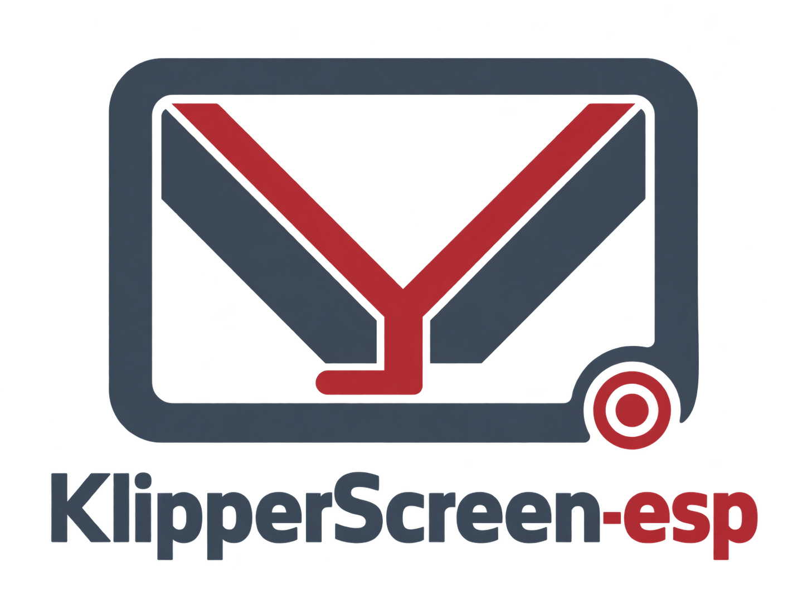
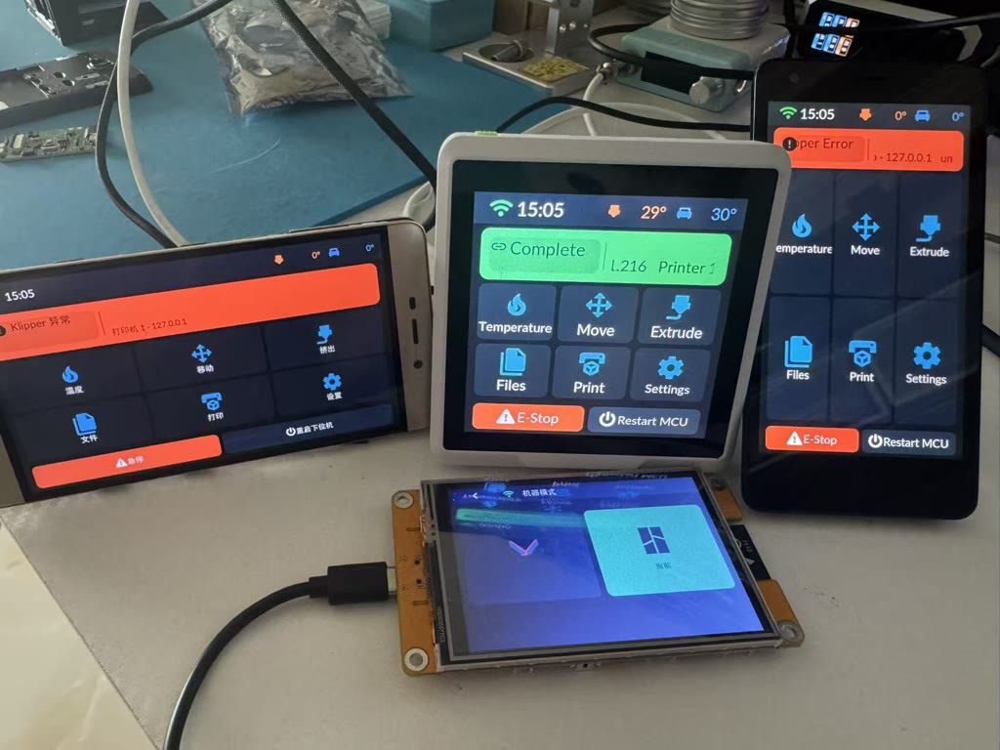
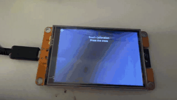

# KlipperScreen-esp

  

**KlipperScreen-esp** is a compact, cross-platform display and controller for 3D printers. It runs on inexpensive ESP32 boards and Windows/macOS desktops, provides full **Klipper** control through **Moonraker**, and adds read-only **Bambu Cloud** monitoring on ESP32 and desktop. Its shared LVGL UI supports touch, rotary encoder, mouse, keyboard, or mixed input; the EC11 reference target demonstrates a rotary-only device.

The separately named SDL2 **simulator** uses mock data for layout development, input experiments, and screenshot testing without a printer.

## Features

- **Main** — nozzle/bed/chamber temp cards, print progress, quick actions
- **G-code files** — thumbnails, metadata, history, print/delete
- **Control** — axis jog & homing, extrude/retract with cold-extrusion guard, temperature presets (PLA/PETG/ABS/cooldown), emergency stop & firmware restart with confirmation
- **Print fine tuning** — open from the upper-right corner of Job Status while printing or paused. Z uses separate 0.01/0.05mm steps; speed and flow share 1%/5%/10%/25% steps. Tap a value to restore 0mm/100%. Not enabled on Wio Terminal due to executable flash limits.
- **Manual bed leveling** — the `bed_level` menu reads 3/4 screw positions from `[bed_screws]` or `[screws_tilt_adjust]`, moves safely to a selected screw and shows probe-assisted screw adjustments. Missing configuration displays a setup hint; motion is disabled while printing or paused. Not enabled on Wio Terminal due to executable flash limits.
- **Robust link** — WebSocket auto-reconnect, app-level heartbeat with RTT display, zombie-connection detection, Klipper error toasts (e.g. endstop not triggered)
- **Bambu status monitor** — ESP32 and desktop support sign-in, verification codes, bound-device selection, and cloud MQTT status sync. Cloud mode is read-only; LAN Developer Mode controls are reserved for a later backend.
- **Extras** — "Umeko" boot animation, 5 languages (EN / 简中 / 繁中 / FR / IT, fade-to-black reboot on switch), brightness slider, auto screen-off with touch wake, and a title-bar clock synced from the active backend's standard HTTP time
- **Input paths** — no-touch rotary boards need no touch layer; resistive touch uses a board-specific calibration path; capacitive touch normally reports screen coordinates directly. Touch and rotary can coexist.

## Supported boards

| Board | Display | Touch | MCU | Status |
|---|---|---|---|---|
| CYD 2432S028R | 2.8" 320×240 ILI9341 SPI | XPT2046 resistive | ESP32 | ✅ Stable |
| CYD 2432S028R-PLUS | 2.8" 320×240 ST7789 SPI | XPT2046 resistive | ESP32-WROOM-32E | 🆕 New, CYD pinout |
| E32R35T (ESP32-32E 3.5") | 3.5" 480×320 ST7796 SPI | XPT2046 resistive (shared bus) | ESP32-32E | ✅ Stable |
| esp32s3-st7789-320_240-ec11 | 240×320 ST7789 SPI | None, rotary only | ESP32-S3 N16R8 | ✅ Official reference, contributor tested |
| esp32-st7735s-128_160-ec11 | 1.8" 128×160 ST7735S SPI | None, rotary only | ESP32 | 🆕 New, CYD-compatible pinout |
| esp32-st7789-320_240-ec11 | 240×320 ST7789 SPI | None, rotary only | ESP32 | 🆕 New, CYD-compatible pinout |
| esp32-ILI9341-320_240-ec11 | 240×320 ILI9341 SPI | None, rotary only | ESP32 | 🆕 New, CYD-compatible pinout |
| esp32-ST7796-320_240-ec11 | 240×320 ST7796 SPI | None, rotary only | ESP32 | 🆕 New, CYD-compatible pinout |
| esp32s3-st7796-480_320-xpt2046-ec11 | 480×320 ST7796S SPI | XPT2046 resistive (shared bus) + EC11 | ESP32-S3 N16R8 | 🆕 New |
| esp32s3-ILI9488-480_320-xpt2046-ec11 | 3.5" 480×320 ILI9488 SPI | XPT2046 resistive (shared bus) + EC11 | ESP32-S3 N16R8 | 🆕 New, MKS PI-TS35 |
| esp32s3-ILI9341-320_240-xpt2046-ec11 | 320×240 ILI9341 SPI | XPT2046 resistive (shared bus) + EC11 | ESP32-S3 N16R8 | 🆕 New |
| JC8048W550 | 5" 800×480 ST7262 RGB parallel | GT911 capacitive | ESP32-S3 | ✅ Stable |
| esp32c3-st7789-320_240-ec11 | 240×320 ST7789 SPI | None, rotary only | ESP32-C3 | 🆕 New, LuatOS CORE & Super Mini |

Full pinouts and hardware details: [Supported boards](boards.md).

## Quick start

1. Download the zip for your board from [Releases](https://github.com/umeiko/KlipperScreen-esp/releases), unzip, then `flash.bat COMx` (Windows) or `./flash.sh /dev/ttyUSB0`
2. Settings → WiFi: scan → pick AP → enter password
3. Settings → Printer Connection: pick a printer slot and choose Klipper or Bambu mode; for Klipper, enter the host IP + port (default 7125), while Bambu continues to its LAN or cloud settings

For self-compiling see the repo README; to run the firmware on your own board see the [porting guide](porting.md). Start its input section by choosing the no-touch or touch route, then choose resistive or capacitive touch where applicable.

## Touch calibration (resistive-touch boards)

Resistive-touch boards (XPT2046: CYD 2432S028R / 2432S028R-PLUS, E32R35T, and the ESP32-S3 480×320 XPT2046 variants) support two-point calibration. A board without calibration data enters the calibration screen automatically on first boot; boards whose firmware ships default parameters can be re-calibrated anytime if taps feel off:

- **While flashing**: the release package scripts (`flash.bat` / `flash.sh`) ask at the end whether to calibrate — answer `y` and the board is sent into the calibration screen over serial automatically. The developer path `tools/build-esp32.sh <board> flash COMx` asks the same question.
- **Anytime**: connect a serial terminal at 115200 8N1 and send `caltouch`; the device reboots straight into the calibration screen.

Tap the two crosses precisely; the result is saved to flash and loaded on every boot.

## Documentation map

- [Supported boards](boards.md) — hardware info and pinouts of existing boards
- [Porting to your own board](porting.md) — the BSP contract and implementation notes
- [Screenshots](screenshots.md) — current English desktop simulator screens
- [Architecture](architecture.md) — shared UI, BSP, desktop controller, and simulator structure
- [Bambu integration notes](bambu-integration-architecture.md) — current read-only cloud boundary and planned LAN path

## License

MIT. Repository: [github.com/umeiko/KlipperScreen-esp](https://github.com/umeiko/KlipperScreen-esp)
