# Screenshots

A tour of every panel, captured from the Windows desktop build at 800×480 against the bundled [virtual printer](https://github.com/umeiko/KlipperScreen-esp/tree/main/scripts/virtual-printer) (fake klippy + real mainline Moonraker), so the data on screen — temperatures, fans, macros, file list, print progress — is live API data, not mock pixels. All panels share the same UI code with the ESP32 firmware; smaller screens get the same layouts with a compact theme.

## Home & printing

### Main screen

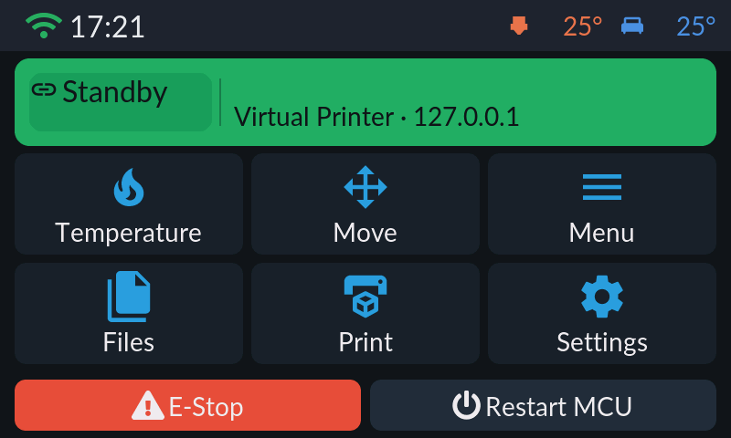

The status card shows the connection state at a glance (green = connected, yellow = disconnected, red = Klipper error) with the printer name and address, plus live print progress while a job runs. The grid jumps to Temperature, Move, Menu, Files, Print and Settings; E-Stop (M112) and Restart MCU (FIRMWARE_RESTART) sit at the bottom behind a confirmation dialog. Tapping the status card during a print jumps straight to the job status panel.

### Job status

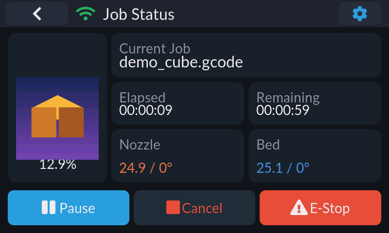

Live view of the running job: slicer thumbnail and progress percentage (on platforms with G-code thumbnail support; a progress ring otherwise), file name with layer counters, elapsed and remaining time, and current/target nozzle and bed temperatures — tap either temperature card to jump to the temperature panel. Buttons follow the job state: Pause/Cancel/E-Stop while printing, Resume while paused, Restart (reprint) and Main Menu after completion. The gear icon in the title bar opens Fine Tune.

### Fine tune

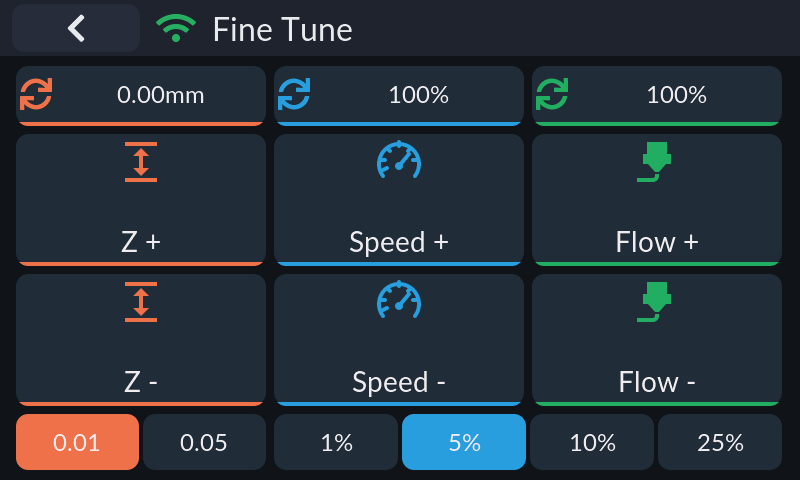

Runtime tuning while printing or paused: Z offset in 0.01/0.05 mm steps (tap the value to zero it), speed (M220) and flow (M221) in selectable 1/5/10/25% steps. Changes are runtime-only and never written to SAVE_CONFIG; the panel exits itself when the job ends. Available on Klipper-mode connections while a job is printing or paused.

### Print files

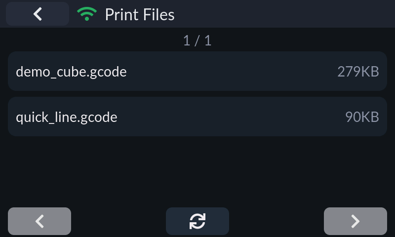

The G-code file list, eight rows per page with prev/next paging and a refresh button, sorted case-insensitively by path (ordering done by Moonraker). File names scroll when too long; sizes show in KB/MB. Tapping a file opens its detail page with print/delete actions (delete is a two-tap confirm). On ESP32 the list is fetched with a streaming parser, so memory use stays flat no matter how large the file library is.

## Klipper controls (Menu)

### Menu

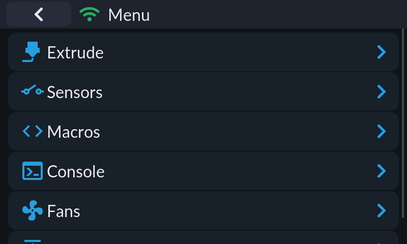

Entry point for the Klipper-only tools: Extrude, Sensors, Macros, Console, Fans and Z Calibrate.

### Temperature

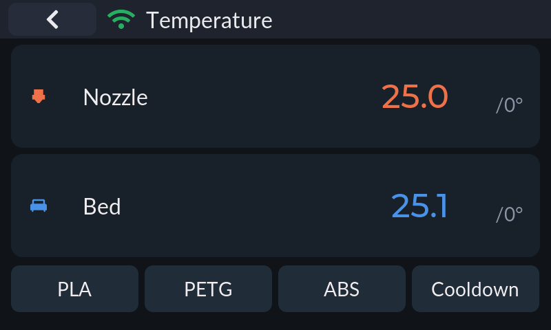

Nozzle and bed cards show current (0.1° precision) and target temperatures. Preset row: PLA / PETG / ABS / Cooldown. Targets can be typed into a keypad popup, or — with a rotary encoder — edited in place: press to enter edit mode, turn to adjust (fast turns auto-accelerate from 1°C to 10°C steps), and the value commits 300 ms after you stop. Read-only in Bambu cloud-monitor mode.

### Move

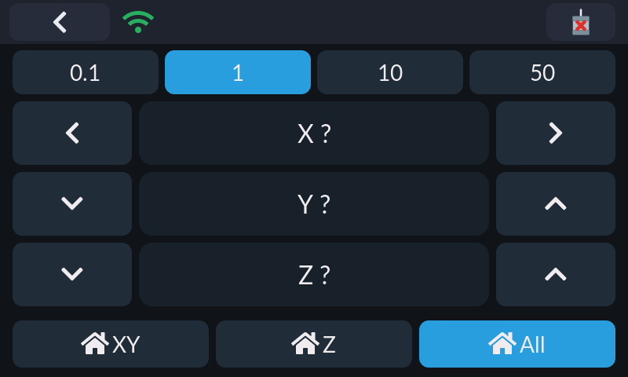

Jog X/Y/Z in 0.1/1/10/50 mm steps, with XY / Z / All homing buttons and a Motors Off (M84) button in the title bar (confirmation required). Axes that have not been homed show `?` instead of a position.

### Extrude

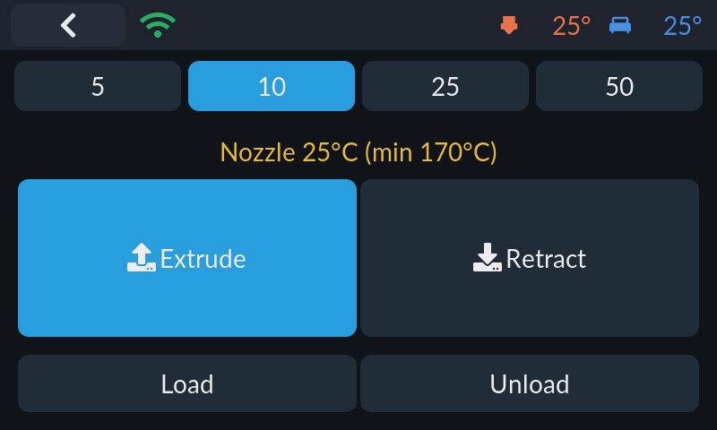

Extrusion amount selector (5/10/25/50 mm) with large Extrude/Retract buttons. The panel shows the live nozzle temperature against the minimum extrusion temperature and refuses to extrude below 170°C with a toast warning.

### Fans

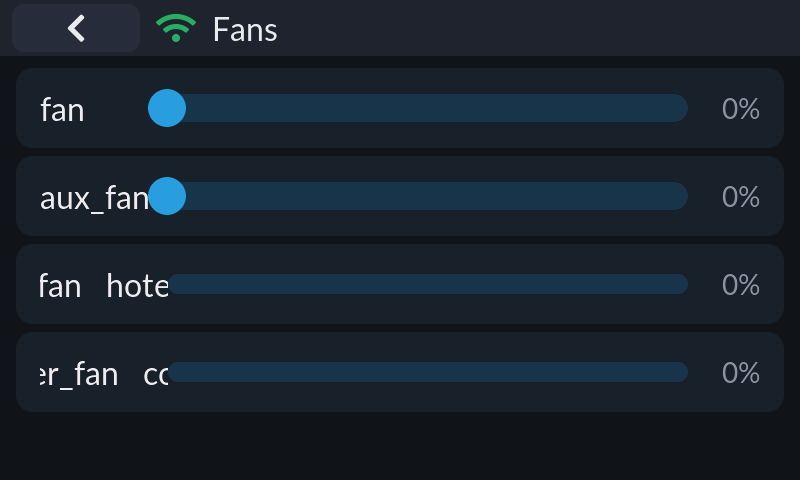

Every fan on the printer, one row each: controllable fans (part cooling, `fan_generic`) get a 0–100% slider that only sends M106/SET_FAN_SPEED when you release it; thermostat fans (`heater_fan`, `controller_fan`) show as read-only bars.

### Sensors

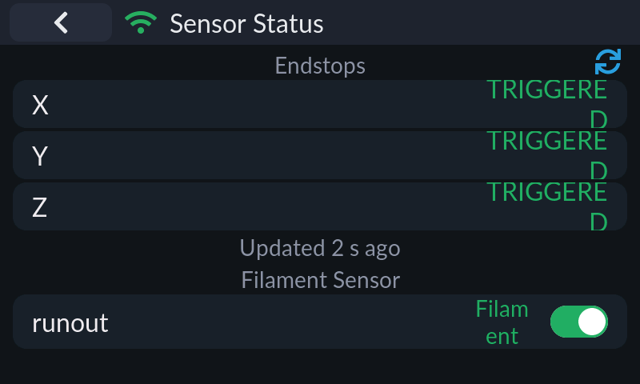

Endstop states for X/Y/Z (triggered/open/unknown) with a manual refresh button and an "updated N s ago" stamp, plus filament runout sensors with live state and an enable/pause switch.

### Macros

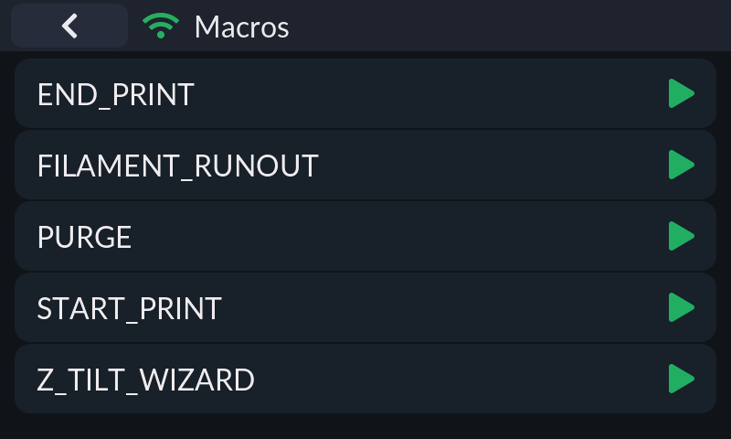

All G-code macros from the printer configuration; tap to run. On desktop builds each row also has a direct-run button, and parameterized macros get an edit button that opens a per-parameter form (defaults pre-filled from `{params.X|default(...)}`) before execution.

### Console

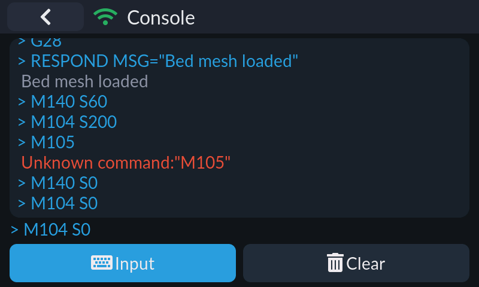

A G-code terminal: scrollable response log colored by type (commands, errors, warnings — M105 temperature polls are filtered out), a command entry with on-screen keyboard, and a clear button. History comes from `server.gcode_store`, live lines from `notify_gcode_response`.

### Z Calibrate

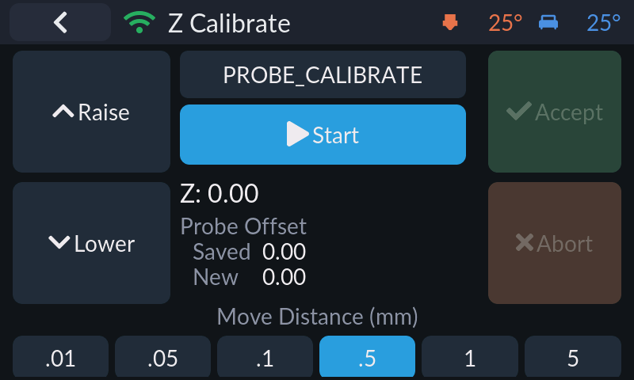

Guided first-layer calibration modeled on KlipperScreen: pick PROBE_CALIBRATE or Z_ENDSTOP_CALIBRATE, raise/lower the nozzle with TESTZ in six step sizes (0.01–5 mm), then Accept to save or Abort (with confirm) to discard. Calibration state is driven by the `manual_probe.is_active` subscription.

## Settings

### Settings

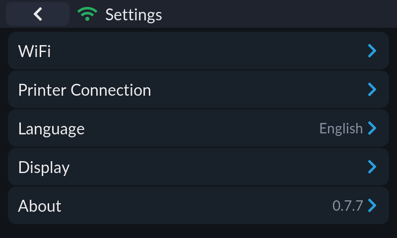

Hub for Wi-Fi, printer connection, language, display settings and the About page (with version). The Wi-Fi row only appears on platforms with Wi-Fi support.

### Printer connection

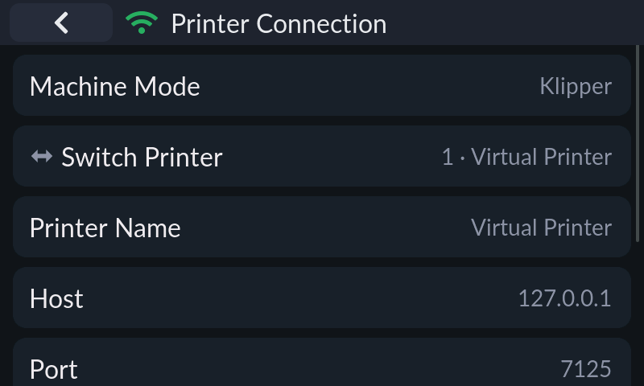

Per-slot connection editor: machine mode, printer switcher, display name, host, port (default 7125) and API key (masked). With a rotary encoder the host field opens a dedicated octet-by-octet IPv4 editor; touch/keyboard uses a text box. Save & Connect persists and reconnects immediately; the status line shows the live connection state including a heartbeat latency in ms.

### Printer switcher

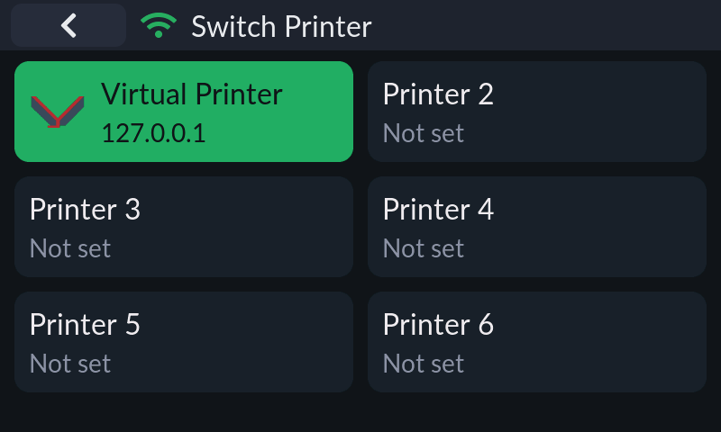

Six printer slots in a 2×3 grid, each with a mode logo (Klipper/Bambu), name and address; the active slot is highlighted. Tapping a slot switches the active connection immediately.

### Machine mode

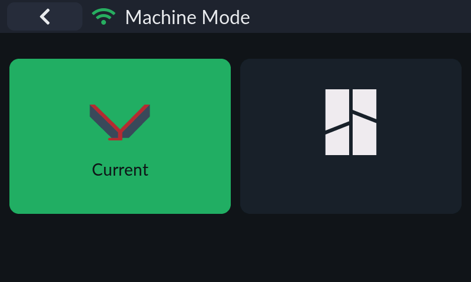

Switches the slot between Klipper (Moonraker) and Bambu Lab modes with a confirmation dialog; the mode decides which panels and capabilities are available.

### Display settings

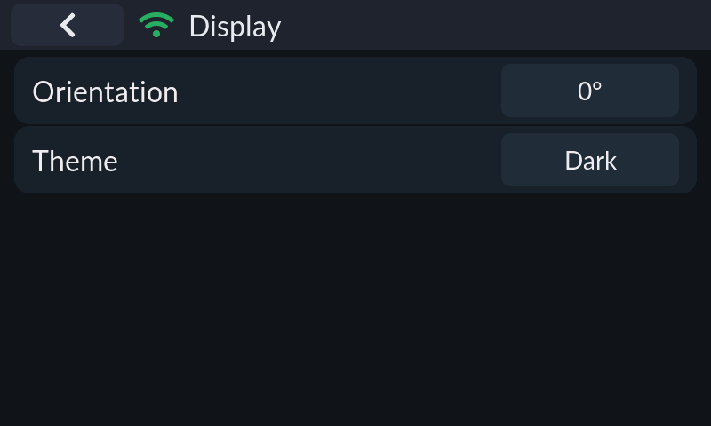

Display-related options in one place: color inversion / 180° rotation / horizontal mirroring (on panels with hardware support), screen orientation (0/90/180/270°, desktop builds), backlight and screen-off timeout (ESP32 and Linux hosts), encoder step tuning with a 20-second turn-test confirmation (encoder boards), color order, and dark/light theme.

### Backlight

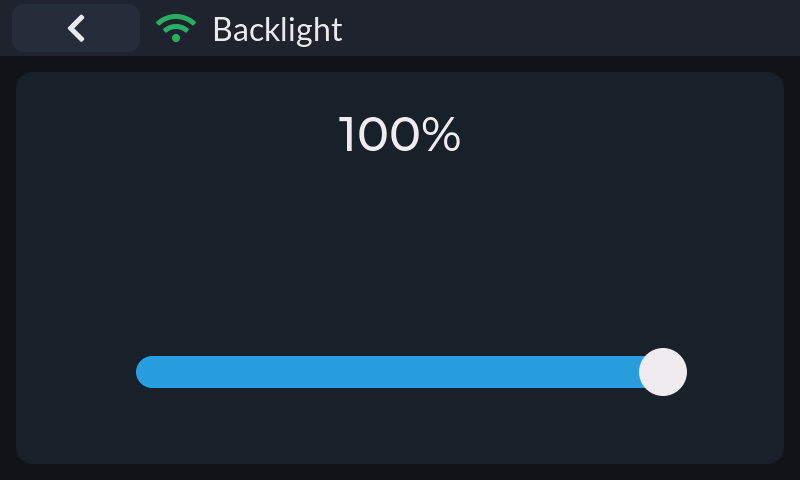

Large percentage readout plus a slider (5–100%, floored at 5% so the screen can never go fully dark). The value is written to flash only when you release the slider.

### Wi-Fi

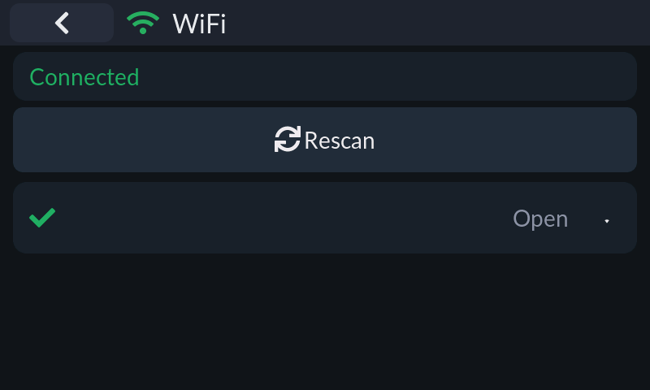

Status card (connected SSID + IP), a scannable AP list with encryption and signal-strength icons, password entry for secured networks, and a connection progress overlay with timeout. Credentials persist and reconnect on boot. Available on ESP32, Windows (netsh) and Linux (nmcli).

### Language

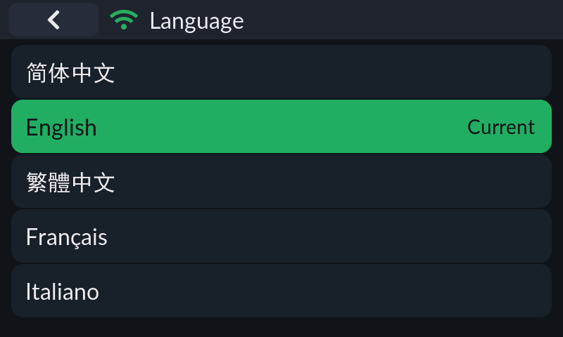

UI language selection with the active one highlighted. ESP32 reboots into the new language; desktop builds rebuild the UI in place without a restart.

### About

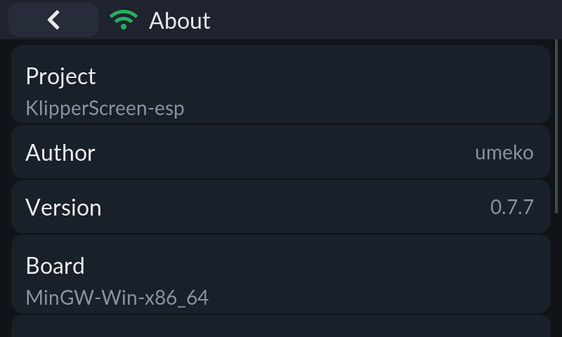

Version, board/build target, framework versions (ESP-IDF / SDL2, LVGL), repository link and license. Linux-host and Android builds also get the self-update entry here.

## Bambu Lab

### Link mode

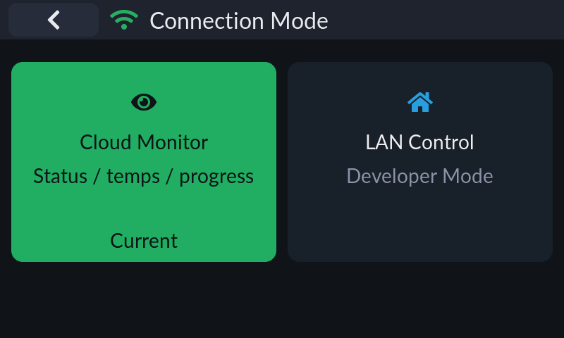

Chooses how a Bambu slot talks: cloud monitor (status/temperatures/progress, read-only) or LAN control (developer mode).

### Bambu account

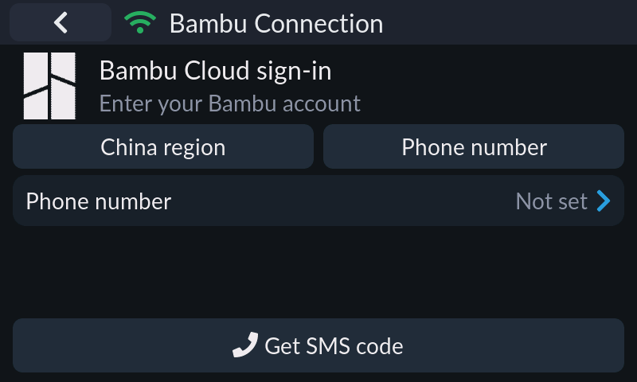

Bambu cloud sign-in and device binding: region selector (China/Global), phone-number + SMS-code or email + password login, TFA/verification-code flow, then a pick list of the account's printers with online state. The selection persists as the slot's bound device.
